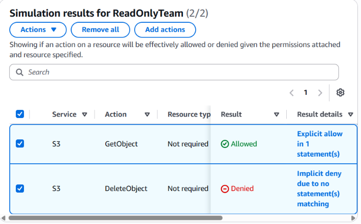
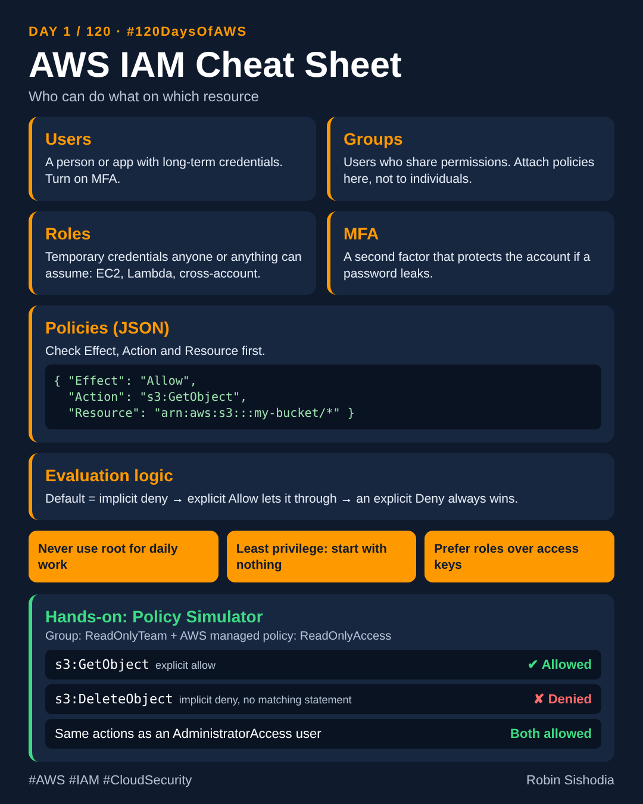

# Day 1: AWS IAM, the front door to everything

Part of my [#120DaysOfAWS](../README.md) series.

- Article: https://sishodiarobin.hashnode.dev/day-1-120-120daysofaws-iam-the-front-door-to-everything-in-aws
- [article.md](article.md): the full write-up
- [iam-cheatsheet.png](iam-cheatsheet.png): one-page cheat sheet
- [linkedin-caption.md](linkedin-caption.md): the LinkedIn post

## Hands-on

1. Created a user group `ReadOnlyTeam` and attached the AWS managed policy `ReadOnlyAccess`.
2. Tested two S3 actions in the IAM Policy Simulator:
   - `s3:GetObject`: Allowed (explicit allow)
   - `s3:DeleteObject`: Denied (implicit deny)
3. Ran the same test against an `AdministratorAccess` user: both Allowed.

