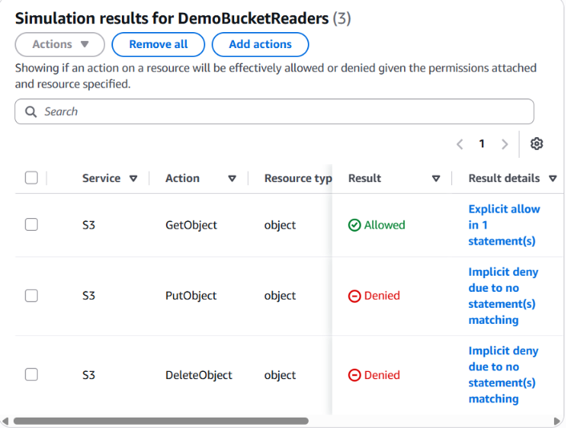
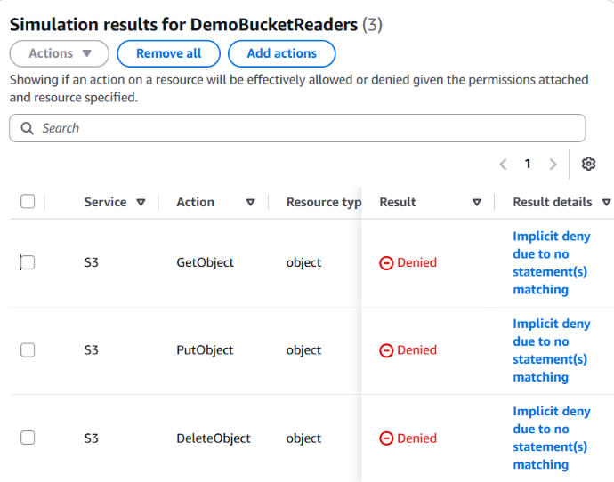
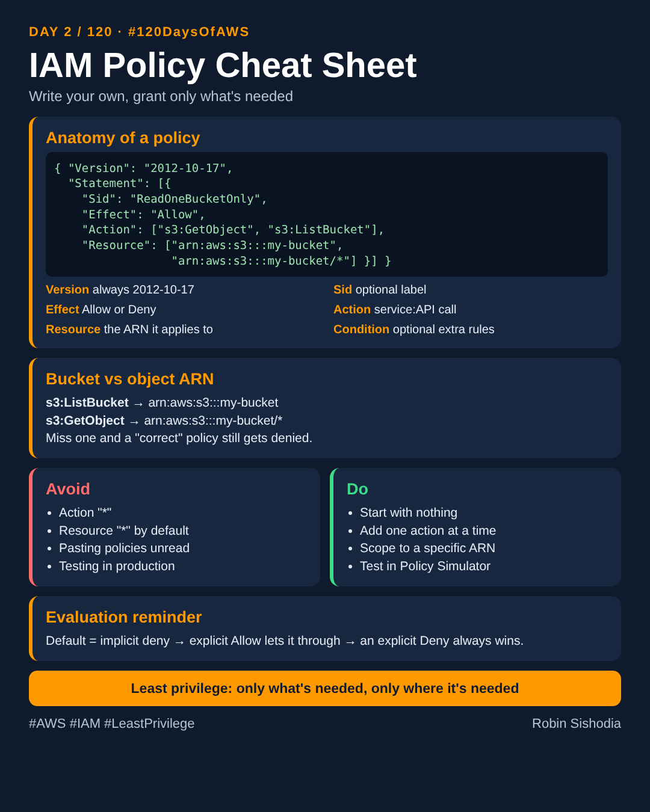

# Day 2: Writing a custom IAM policy from scratch

Part of my [#120DaysOfAWS](../README.md) series.

Published article: https://sishodiarobin.hashnode.dev/day-2-120-120daysofaws-writing-a-custom-iam-policy-from-scratch

- [article.md](article.md): the write-up
- [policy-read-demo-bucket.json](policy-read-demo-bucket.json): the custom policy (read one S3 bucket only)
- [iam-policy-cheatsheet.png](iam-policy-cheatsheet.png): one-page cheat sheet
- [linkedin-caption.md](linkedin-caption.md): the LinkedIn post

## Hands-on

1. Created the customer managed policy `ReadDemoBucketOnly` from the JSON above.
2. Created the group `DemoBucketReaders` and attached only that policy.
3. Tested in the IAM Policy Simulator:
   - `s3:GetObject` on `robin-120days-demo/*`: Allowed (explicit allow)
   - `s3:PutObject` and `s3:DeleteObject` on the same bucket: Denied (implicit deny)
   - `s3:GetObject` on another bucket: Denied (implicit deny)

Test A (demo bucket):

Test B (another bucket):

